# Project 02 — E-Commerce Executive Analytics Lab (October 2026)

**Repository:** `arthur-fay/arthur-fay.github.io` · **Branch:** `feat/ecommerce-analytics-lab` · **Status:** review branch; nothing is published until the owner merges.

This document records what the lab was built from, the design decisions, what was measured and what remains. It follows the same rule as the rest of the site: nothing is claimed that was not checked, and every figure on the new page carries its provenance. The lab's own documentation is [lab/ecommerce/README.md](../lab/ecommerce/README.md).

## 1. Sources inspected

The source project is the public repository [customer-revenue-analytics](https://github.com/arthur-fay/customer-revenue-analytics), checked at commit `795257de2a80f5118e62d5a2eb84cd063aeef283` on 21 October 2026 through a read-only clone.

| Source | What it contributed | What was deliberately not taken from it |
| --- | --- | --- |
| `README.md` | The six KPIs (99K orders, R$15.84M revenue, 96K customers, R$159.33 average order value, 97.02% delivery rate, 91.88% on-time delivery rate), the two leading categories (≈ R$1.44M and ≈ R$1.31M), the seven insight sentences, the ten documented tables, the five DAX measures quoted verbatim, the tool list | Nothing beyond what it states; "monthly revenue increased considerably" is quoted, not turned into numbers |
| `01 Raw Screenshots/Ecommerce_Executive_Dashboard.png` and `04 Exports/Ecommerce_Executive_Dashboard.pdf` | The data labels printed on two visuals: Orders by Status (96,478 / 1,729 / 1,234) and Top 10 Product Categories by Revenue (ten values printed to R$0.01M, one label truncated by the report itself); the slicer range 2016–2018 and the trend axis January 2017 to July 2018 | The monthly trend line, which prints no values and is therefore not redrawn |
| `01 Raw Screenshots/Ecommerce_Data_Model.png` | The column names visible in each table panel (partial, the panels are scrolled), the hidden `Value` column of `KPI_Measures`, the many-side markers on the two transactional fact tables | Join keys, cardinalities and cross-filter directions, which cannot be read reliably from the picture and are not stated in the README |
| `03 PBIX FILE/Ecommerce_Executive_Dashboard.pbix`, file `Report/Layout` inside the archive | Which measure or column each visual queries and the filters it applies (six cards, the trend filtered to `is_complete_analysis_month = 1`, the Top 10 filter, the status chart, the two slicers) | The `DataModel` part of the archive is a binary database and was not parsed; nothing about relationships was inferred from it |

Three cross-checks tie the sources together and are shown on the page: 96,478 ÷ 99,441 = 97.02% (the published delivery rate), R$159.33 × 99,441 = R$15,843,935 (rounds to the published R$15.84M), and R$15.84M ÷ R$159.33 ≈ 99,416 (within 0.03% of the exported order total, the difference being the rounding of the revenue).

## 2. Design direction

The page keeps The Architect Lab's drafting-table language (numbered sections, monograph typography, hairline frames, the shared header and footer) and adds four conventions of its own:

- **Provenance badges.** Every tile and chart carries one word: Published, Exported, Derived or Hypothetical, drawn as a labelled chip with a small swatch (solid, dashed, grey or hatched). The hero's ledger counts what the page is built from: 6 KPIs, 2 categories, 5 DAX measures, 10 tables, 0 monthly values.
- **Hypothetical is hatched.** Simulator marks use an amber hue *and* a 45° hatch, and every simulator tile, chart and status message says "hypothetical", so the distinction never rests on colour alone.
- **Charts are code.** All six charts are SVG rendered from `model.js` at the container's measured width, with thin bars, rounded data ends, hairline axes, values at the tip, a legend whenever two series are present, a hover tooltip, keyboard reading of each mark and a table view. Three measures of different scale are indexed to the baseline = 100 on one axis rather than drawn on two.
- **Validated colour.** The two chart hues were chosen from the site's own teal and amber families and validated with the data-visualization palette validator against both chart surfaces: dark `#2aa6bb` / `#bd8a2a` (worst colour-vision-deficiency pair ΔE 18.2, normal-vision 21.2, all checks pass), light `#0f8aa3` / `#a8761a` (ΔE 17.3 and 20.7, all checks pass). The site's original teal reads as grey under the chroma check and was therefore not used for marks.

## 3. What was built

- `lab/ecommerce/model.js` — the pure engine (no DOM): transcribed figures with provenance, derived arithmetic, the KPI, DAX, table, visual, pipeline, preset, formula and assumption definitions, scenario calculation with validation, and formatters. Deeply frozen.
- `lab/ecommerce/index.html`, `lab.css`, `app.js` — the page: executive dashboard (six KPI tiles with DAX, four charts, the trend note), what-if simulator (four levers with typed twins, presets, reset, eight outputs, two charts, formulas and assumptions), data-model explorer (ten table buttons laid out as a diagram with connector lines, a detail card, the DAX lineage, the pipeline and the report wiring), methodology and engineering notes.
- Site integration: a prominent "Open the interactive analytics lab" link on plate 02, links in the section cut and the footer, the Interactive filter now including the plate, the ledger counting three labs, the sitemap, the offline checker, `package.json`, the CI workflow and the README.
- Tests: `tests/unit/ecommerce.test.js` (engine), `tests/unit/ecommerce-page.test.js` (markup equals engine), `tests/unit/ecommerce-contrast.test.js` (tokens in both themes), `tests/browser/ecommerce.test.js` (Playwright at five widths in both themes); the pathfinding and security suites updated for the third interactive project.

Captures from the review environment (headless Chromium, Linux system fonts; the sticky header was unstuck for the section captures so the content is not covered):

| | |
| --- | --- |
| 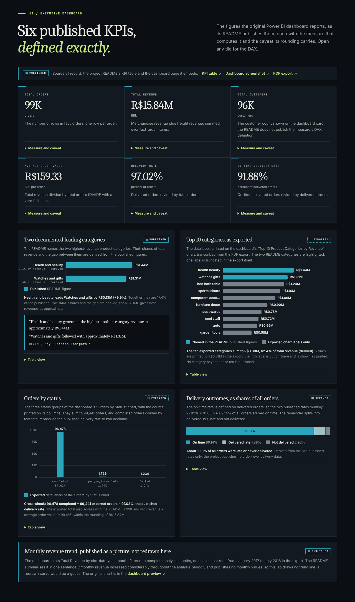 | 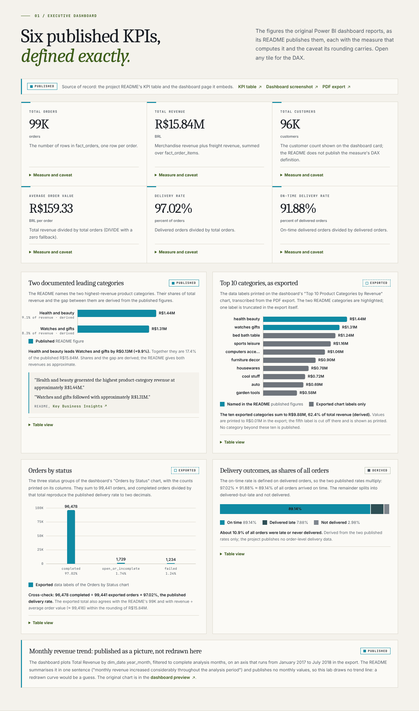 |
| 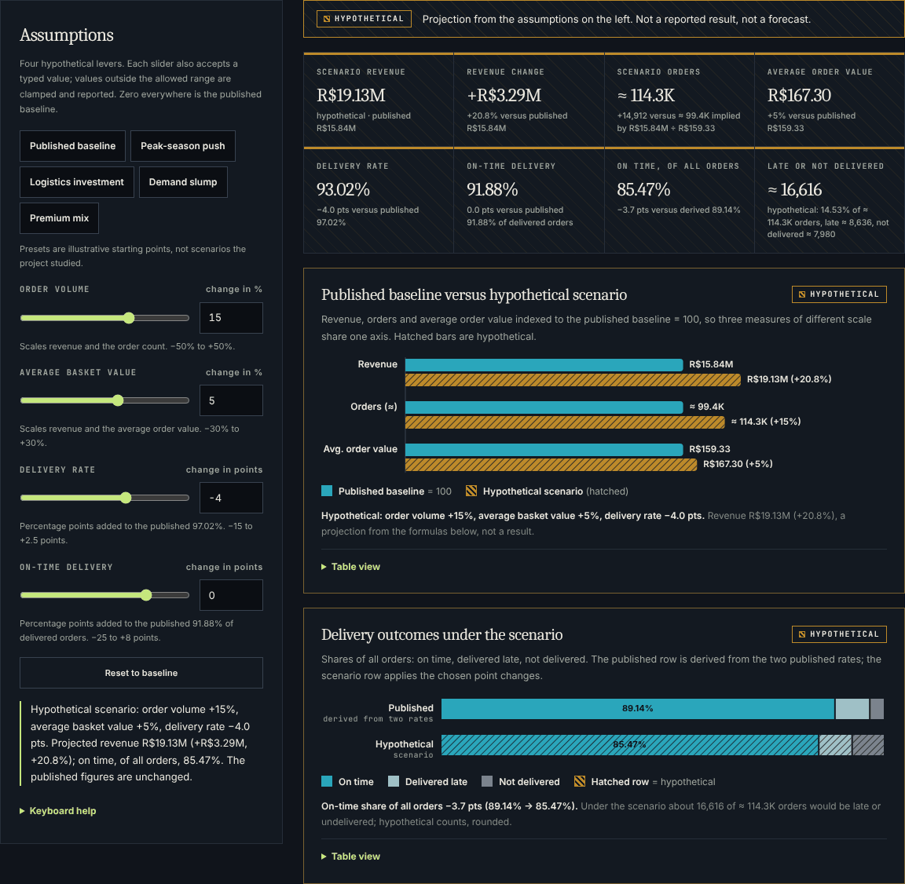 | 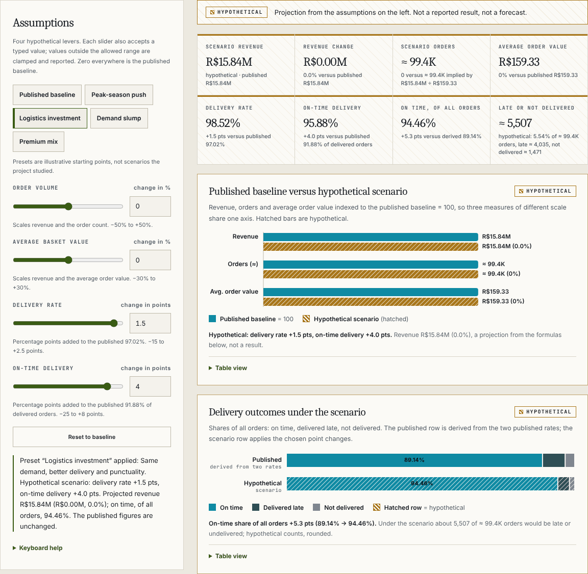 |
| 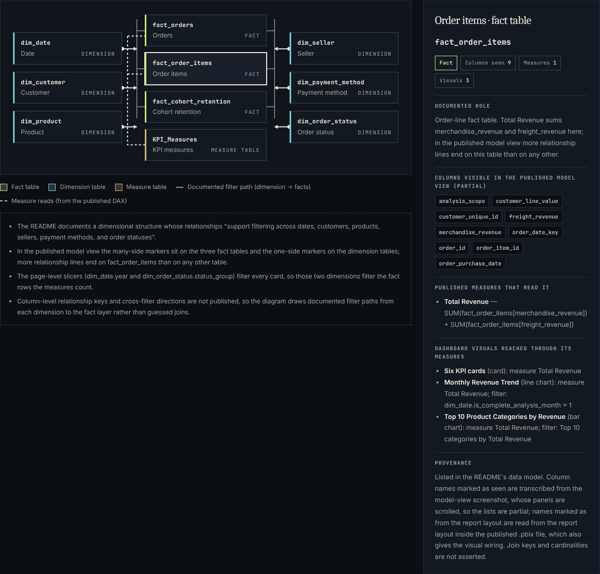 | 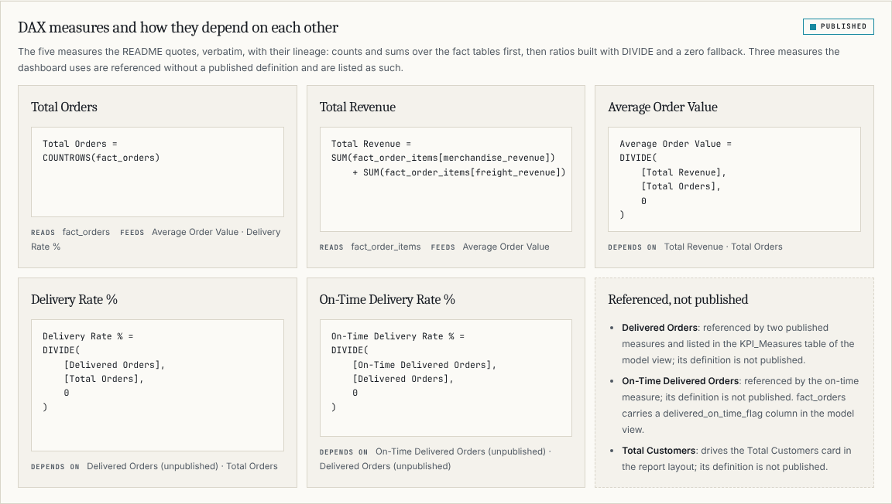 |
| 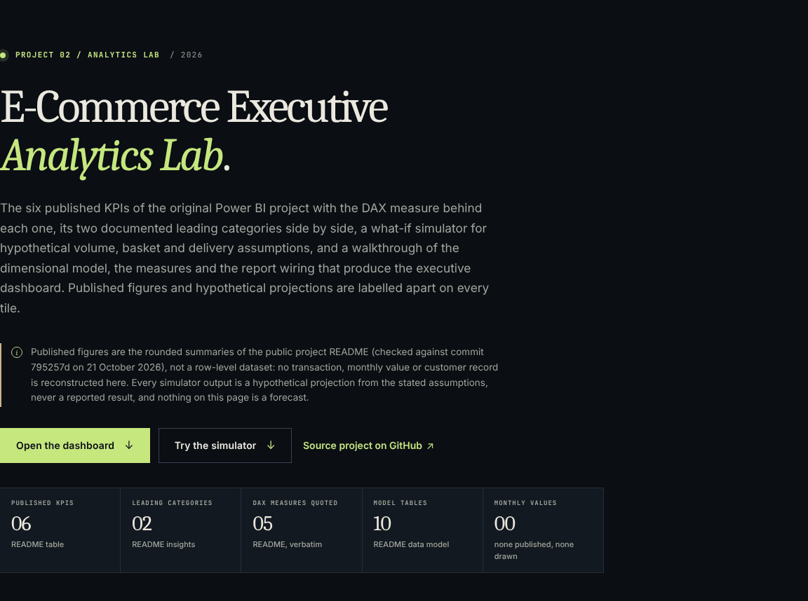 | 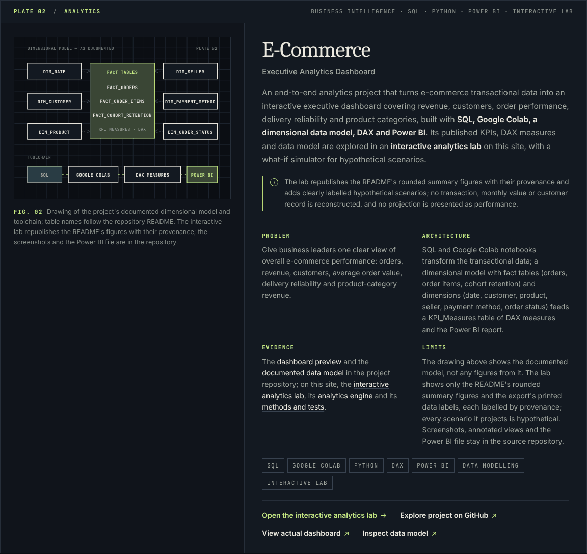 |
| 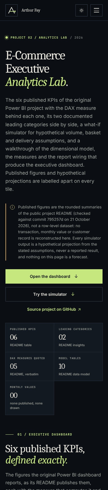 | 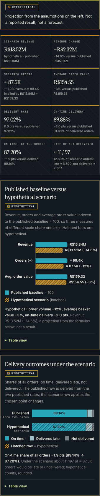 |
| 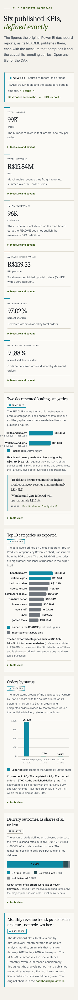 | |

## 4. Measurements

All numbers below were measured in the review environment (Linux, headless Chromium 141, Node 22, Lighthouse 13.5.0 installed outside the repository, pages served by the repository's own static test server). They are not live-site measurements.

**Lighthouse**

| Page | Preset | Performance | Accessibility | Best practices | SEO | FCP | LCP | TBT | CLS |
| --- | --- | ---: | ---: | ---: | ---: | ---: | ---: | ---: | ---: |
| `/lab/ecommerce/` | mobile, run 1 | 98 | 100 | 100 | 92 | 1.9 s | 2.2 s | 10 ms | 0 |
| `/lab/ecommerce/` | mobile, run 2 | 99 | 100 | 100 | 92 | 1.7 s | 1.8 s | 10 ms | 0 |
| `/lab/ecommerce/` | desktop | 100 | 100 | 100 | 92 | 0.4 s | 0.5 s | 0 ms | 0 |
| `/` | mobile | 99 | 100 | 100 | 92 | 1.6 s | 1.7 s | 100 ms | 0 |

The first mobile run of the lab, before the review, scored 94 with 180 ms of total blocking time and a "forced reflow" insight: the chart pass read each frame's width and then wrote its SVG, alternating layout reads and writes. The pass now reads every width first, then renders; the insight no longer fires on mobile and total blocking time fell to 10 ms. SEO is 92 on every page for the reason recorded for the redesign: Lighthouse's `robots-txt` audit fetches `robots.txt` from inside the page, which the strict Content Security Policy blocks, so the audit reports the file as invalid although it is valid and served. No accessibility or best-practices audit scored below 1 on any run.

**Transfer size (gzip, as GitHub Pages serves it)**

| File | Raw | Gzip |
| --- | ---: | ---: |
| `lab/ecommerce/index.html` | 50.5 KB | 12.1 KB |
| `lab/ecommerce/lab.css` | 26.3 KB | 5.5 KB |
| `lab/ecommerce/app.js` | 43.8 KB | 12.1 KB |
| `lab/ecommerce/model.js` | 31.9 KB | 9.2 KB |
| Page total with the shared `styles.css` (10.4 KB) and `script.js` (3.6 KB) | | ≈ 53 KB |

No image is loaded by the page; the charts are SVG built in the browser.

**Automated tests**

| Suite | Result |
| --- | --- |
| `python3 scripts/check_site.py` | passed (analytics lab: 33 links, 90 IDs) |
| `node --test tests/unit/*.test.js` | 188 passed, 0 failed (133 earlier + 55 new) |
| `node --test tests/browser/*.test.js` | see section 6 for the final run |

**Layout checks** (Playwright screenshots in both themes): no horizontal overflow, nothing cut off at the viewport edge and no console errors at 320, 375, 768, 1280 and 1920 px; the simulator, the chart tooltips and keyboard reading, the table views, the model explorer, the theme toggle, the mobile menu and the reduced-motion state were exercised by script and the captures above were inspected by eye.

## 5. Independent review

_(filled in below once the independent review completed)_

## 6. Remaining limitations

- The source publishes rounded figures only; every derived and hypothetical figure inherits that rounding, and the page says so where it matters.
- The exported category values are read from data labels printed to R$0.01M; one label is truncated in the export itself and is shown as printed rather than guessed.
- Three measures the dashboard uses (`Total Customers`, `Delivered Orders`, `On-Time Delivered Orders`) have no published DAX; they are listed as unpublished, and nothing is inferred about them.
- Column lists come from a scrolled model view and are partial; relationships are described only as the README describes them, so the diagram draws documented filter paths, not joins.
- The simulator is linear and bounded by design: a reasoning aid, not a model of the business.
- Lighthouse was run against the repository's static test server, not the live deployment; `bf-cache` and `robots-txt` fail only because of that setup and should be re-checked after publication.
- Screen readers, Firefox, Safari and low-end devices were not exercised; the review used headless Chromium on Linux, so the system serif renders differently from macOS and Windows.

## 7. After merge

Verify on the live site: `/lab/ecommerce/` at a phone width and a desktop width in both themes, the homepage's three links to the lab, the Interactive filter, the simulator (a preset, a typed value, keyboard on a slider), one chart tooltip by hover and by arrow keys, one table selection in the model explorer, the outbound links to the source repository, and the 404 page for a wrong path under `/lab/`.
