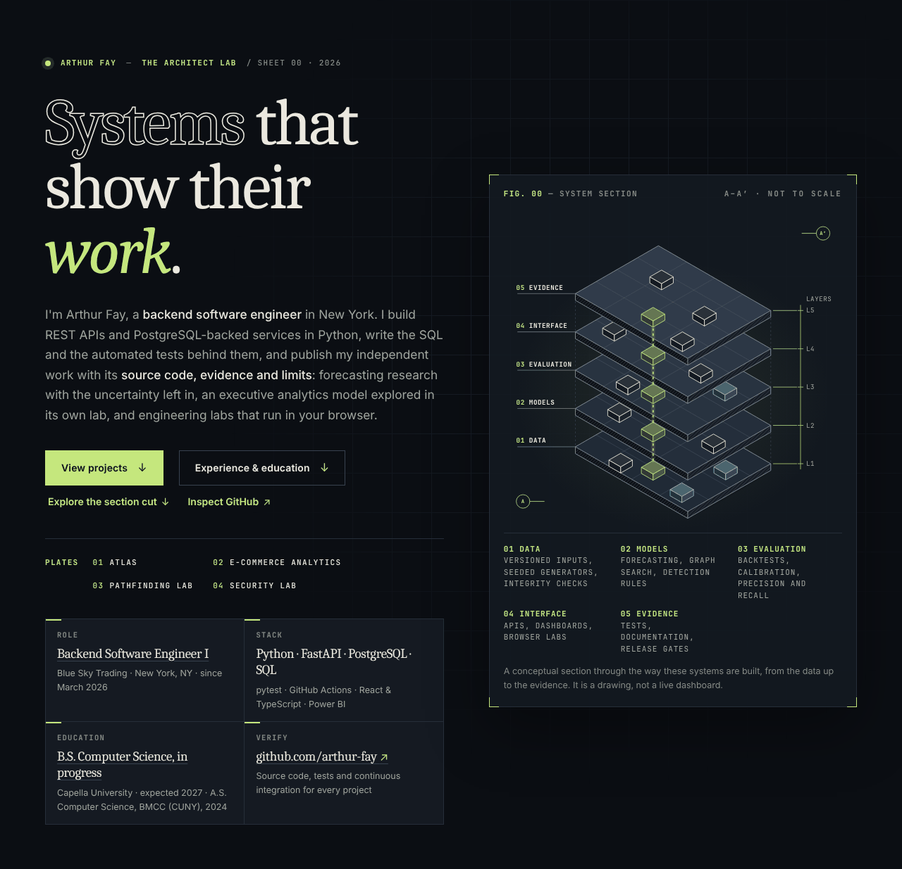
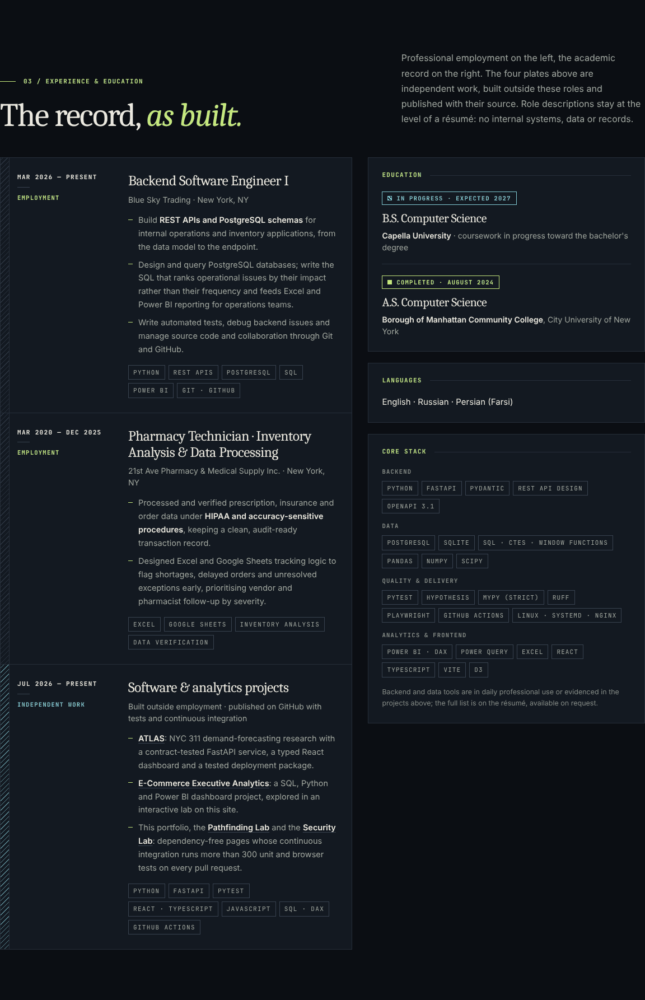
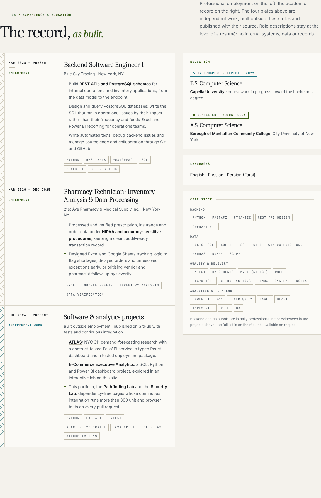
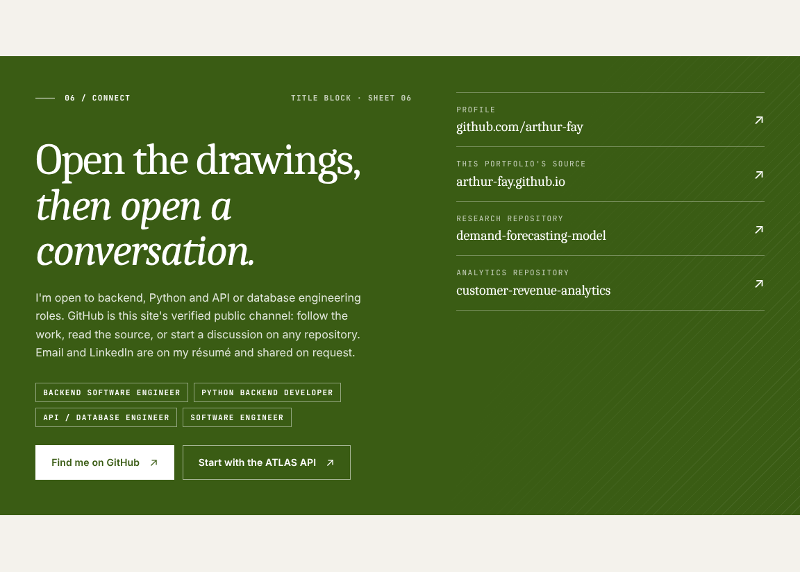
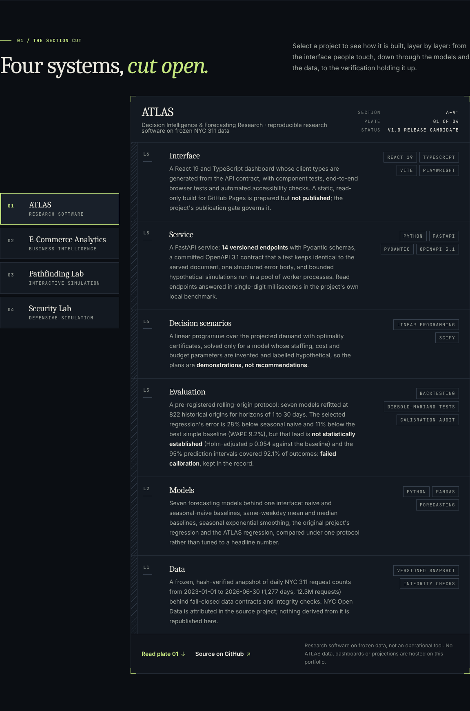
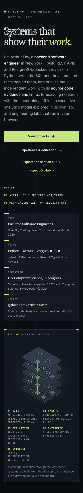
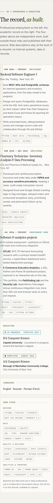
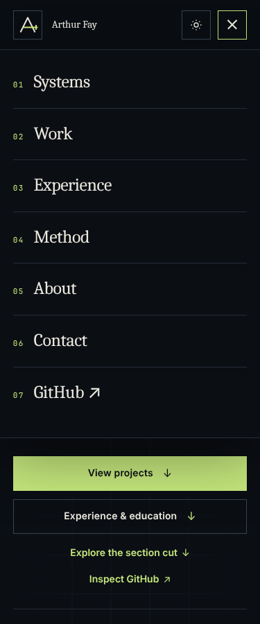
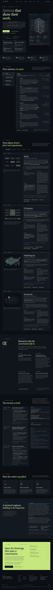
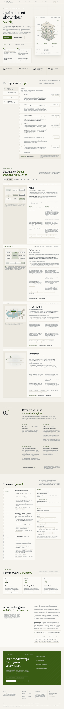

# Professional profile and résumé alignment (October 2026)

**Repository:** `arthur-fay/arthur-fay.github.io` · **Branch:** `claude/arthur-fay-portfolio-upgrade-35axio` · **Status:** review branch; nothing is published until the owner merges.

This document records what the owner's résumé (provided on 21 October 2026) claims, what the three public repositories evidence, what changed on the homepage to present the professional record, what was measured, and which decisions remain the owner's. It follows the rule of the rest of the site: nothing is claimed that was not checked, and the owner's employment and education facts are stated as provided, not embellished.

## 1. Sources inspected

| Source | State inspected | Used for |
| --- | --- | --- |
| The owner's résumé (PDF, provided privately; **not committed**) | 21 October 2026 | Employment, education, languages, skills and the technical claims audited below |
| `arthur-fay/arthur-fay.github.io` | `main` at `669fdd6` (the commit GitHub Pages serves) | The homepage, labs, tests, checker and earlier review records |
| `arthur-fay/demand-forecasting-model` (ATLAS) | `98a88b5`, 2026-10-19, read-only clone with full history (153 commits since 2026-07-18) | README, `docs/BACKTESTING.md`, `docs/UNCERTAINTY.md`, `docs/API.md`, `docs/api/openapi.json`, `docs/DATA_CARD.md`, `docs/DEPLOYMENT.md`, `docs/DEVELOPMENT.md`, `docs/KNOWN_LIMITATIONS.md`, `docs/release/RELEASE_GATE.md`, `pyproject.toml`, `.github/workflows/`, `src/atlas/api/`, `tests/`, `web/package.json` |
| `arthur-fay/customer-revenue-analytics` | `795257d`, 2026-07-15 | README (KPIs, data model, DAX, tools) |

The live site at `https://arthur-fay.github.io/` could not be fetched from the review environment (its egress policy refused the host). The homepage GitHub Pages serves is `main`, which this branch starts from, so the comparison was made against that commit.

## 2. Résumé audit against the repositories

Classification key: **Supported** (repository evidence), **User-provided** (employment, education, languages: not verifiable from public code and stated as provided), **Qualified** (accurate but missing an important qualification), **Not verified** (no public evidence either way), **Potentially misleading or outdated**.

| # | Résumé claim | Classification | Evidence and notes |
| --- | --- | --- | --- |
| 1 | Backend Software Engineer I, Blue Sky Trading, New York, NY, March 2026 to present; REST APIs and PostgreSQL schemas, SQL feeding Excel and Power BI, automated tests, Git/GitHub | **User-provided** | Stated on the site as provided. The résumé's operational specifics (daily incident volumes, named warehouse workflows, vendor audiences) are employer material and were **left off the site**; the owner should confirm they may appear on a résumé. |
| 2 | Pharmacy Technician — Inventory Analysis & Data Processing, 21st Ave Pharmacy & Medical Supply Inc., March 2020 to December 2025 | **User-provided** | Stated as provided; the site mentions no patient data and no transaction volume. "Pharmacy Technician" should match the employer's records; the descriptor after the dash is the owner's. |
| 3 | Capella University, B.S. Computer Science, expected 2027; Borough of Manhattan Community College (CUNY), A.S. Computer Science, August 2024 | **User-provided** | The bachelor's degree is shown as **in progress, expected 2027** in the hero title block, the record and the about copy; a unit test and the checker fail if that wording changes. |
| 4 | ATLAS: "a reproducible forecasting system over 12.3M NYC 311 requests (2023–2026)" | **Qualified** | `docs/DATA_CARD.md`: 12,331,111 requests created over 1,277 days (2023-01-01 to 2026-06-30). ATLAS models **daily counts**; 12.3M is their sum, not a row count processed. The site says "daily NYC 311 request counts … (1,277 days, 12.3M requests)". |
| 5 | "rolling-origin backtests of seven models across 822 forecast origins at 1–30-day horizons under a pre-registered protocol with significance and calibration tests" | **Supported** | `docs/BACKTESTING.md` §3 (seven models), §4 (822 origins, pre-registered protocol), Diebold–Mariano tests; `docs/UNCERTAINTY.md` (calibration protocol). |
| 6 | "the selected model's MAE (WAPE 9.2%) came in 28% below seasonal-naive and 11% below the best simple baseline" | **Qualified; potentially misleading as written** | The figures are right (README "What ATLAS found" 1: MAE 984.9 vs 1,112.2 and 1,371.5; WAPE 9.2 %; 11.4 % and 28.2 %). The résumé omits that the lead over the best baseline is **not statistically established** (95 % interval −256 to +2, Holm-adjusted p 0.054), that the lead over seasonal naive is **borderline** after the M8 size correction (Holm 0.045 under the test's own assumption, 0.068–0.155 under longer error dependence), that a correctly sized selection test would most likely have kept the baseline (size-corrected p 0.069), and that the prediction intervals are **FAILED_CALIBRATION** (92.1 % coverage at a nominal 95 %). The site states the figures only together with these findings; the revised résumé does the same. |
| 7 | "a FastAPI service with 14 versioned endpoints" | **Supported** | `docs/api/openapi.json`: 14 operations (12 under `/api/v1`, 2 under `/health`); 14 route decorators in `src/atlas/api/routers/`. |
| 8 | "Pydantic schemas, a committed OpenAPI 3.1 contract verified by tests" | **Supported** | `openapi.json` declares `"openapi": "3.1.0"`; `tests/test_m5_contract.py::test_committed_contract_is_current`; CI diffs `atlas api openapi` against the committed file; the dashboard's generated client types are diffed against it. |
| 9 | "structured errors, a worker pool for bounded linear-programming simulations" | **Supported** | `docs/API.md` §2: one error body with codes (`errors.py`, `problems.py`); spawned worker processes, no queue (503 `simulations_busy`), deadline kill (504), replacement of dead workers. |
| 10 | "single-digit-millisecond median read latency" | **Qualified** | `docs/API.md` §7: medians 1.2–6.9 ms, p95 at most 11 ms, measured with `atlas api bench` on the developer's machine. Not a deployed-server measurement. |
| 11 | "React 19 + TypeScript dashboard typed from that contract (Vite, Zod, D3, Playwright, axe-core)" | **Supported** | `web/package.json`: react 19.3.0, zod 4.6.5, d3-scale and d3-shape, vite 8.3.1, @playwright/test 1.56.1, @axe-core/playwright 4.13.0; `gen:api` runs openapi-typescript over the contract. |
| 12 | "Packaged an Ubuntu deployment (systemd, nginx TLS, verified activation with automatic rollback, monitoring)" | **Qualified** | `docs/DEPLOYMENT.md` and the CI `deploy-e2e` job: the package is exercised end to end in a disposable Ubuntu 24.04 systemd container (bootstrap, build, activate, fail, roll back, recover, reboot). **Nothing has been deployed** to a real server (`RELEASE_GATE.md`, gate N). The site says "tested end to end in a disposable Ubuntu container, not deployed". |
| 13 | "GitHub Actions CI: Ruff, strict mypy, 1,780+ pytest tests with a coverage gate, shellcheck, and byte-for-byte reproducibility checks" | **Supported** | `.github/workflows/ci.yml` runs each; `pyproject.toml`: `[tool.mypy] strict = true`, `fail_under = 90`; 1,783 `def test_` functions in `tests/` (3,068 passed with parametrization in the release gate's recorded run); `verify` commands compare regenerated runs byte for byte. |
| 14 | ATLAS dates "Jul – Oct 2026" | **Supported** | First commit 2026-07-18 (the original project); the ATLAS milestones were committed 2026-10-12 to 2026-10-19. |
| 15 | Portfolio: "dependency-free, accessible portfolio (strict Content Security Policy, no third-party scripts, reduced-motion support) with CI running 180+ unit and Playwright browser tests on every pull request" | **Supported, figure outdated** | `package.json` declares no dependencies; every page carries `default-src 'none'`; `prefers-reduced-motion` rules; CI ran 192 unit and 122 browser tests on `main` (this branch: 209 and 130). "180+" undercounts; the revised résumé says "300+". |
| 16 | Pathfinding Lab: BFS, Dijkstra, A*, weighted grids, 4/8-directional movement, animated exploration with pause/step, seeded maze generation, measured cost and time, pure unit-tested module | **Supported** | `lab/pathfinding/pathfinding.js`, `lab/pathfinding/README.md`, `tests/unit/pathfinding.test.js`. |
| 17 | Security Lab: seeded synthetic generator with planted scenarios, three explainable sliding-window rules, timeline replay with investigation view, precision/recall against ground truth | **Supported** | `lab/security-events/detection.js`, `lab/security-events/README.md`, `tests/unit/detection.test.js`. |
| 18 | E-Commerce: "99K orders (R$15.8M revenue, 96K customers) … star schema (3 fact tables, 6 dimensions, DAX measures) … revenue trend, order value, top categories, status mix, 97.0% delivery / 91.9% on-time"; "Jul 2026" | **Supported** (one wording note) | README KPI table (99K, R$15.84M, 96K, R$159.33, 97.02 %, 91.88 %), three fact and six dimension tables plus `KPI_Measures`, the five published DAX measures; commits 2026-07-15. The README says "dimensional structure", not "star schema"; the revised résumé uses "dimensional model". |
| 19 | Skills: Hypothesis, Docker, Bash, uv, systemd, nginx | **Supported** | 16 ATLAS test files import Hypothesis; the M6 container test runs under Docker; `deploy/scripts/*.sh` pass shellcheck in CI; `uv.lock`; systemd and nginx templates under `deploy/`. |
| 20 | Skills: Tableau, Google Sheets, Excel (PivotTables, XLOOKUP, SUMIFS) | **Not verified** | No public artefact; professional use only (Excel and Google Sheets are also named in the pharmacy role). Tableau is not evidenced anywhere and is not on the site. |
| 21 | Skills: PostgreSQL | **User-provided** | Professional use only; no public repository uses PostgreSQL (ATLAS reads committed files; the e-commerce project used SQL over transactional data in Colab). The ATLAS plate deliberately does not mention PostgreSQL; a unit test keeps it that way. |
| 22 | Summary: "a contract-tested FastAPI platform with CI/CD, a React/TypeScript dashboard, and executive Power BI reporting" | **Supported** | Items 7–13 and 18. |

## 3. What changed on the homepage

Everything below keeps The Architect Lab's design language (drafting conventions, monograph typography, system font stacks, the hairline frame, the hatch strip) and the site's rules (no dependencies, no inline code, strict Content Security Policy, outbound links to GitHub only, every interaction degrading without JavaScript).

- **Identity.** The hero now says what kind of engineer the owner is and in which stack (backend; Python, FastAPI, PostgreSQL, SQL), keeps the signature headline, and adds a **title block**, the drawing-sheet convention for the facts a reader needs first: Role (links to the record), Stack, Education (in progress, links to the education card) and Verify (the GitHub profile). The hero's second call to action is "Experience & education"; the section cut keeps its entry point as a text link.
- **Navigation.** Six sheets: 01 Systems, 02 Work, 03 Experience, 04 Method, 05 About, 06 Contact; the footer index and the visible sheet numbers follow. Six links no longer fit beside the wordmark and the actions below about 1000 px (the previous five already overflowed between 781 and 870 px, untested before), so the shared header shows the menu button up to 1000 px and the full navigation from 1001 px; the labs inherit this.
- **03 / Experience & education (`#experience`).** "The record, as built": a schedule-style section. Left, three entries with a hatched margin like the strata: two employment entries (dates, kind, title, employer, city, résumé-level responsibilities, technologies) and one **Independent work** entry that links the four plates and states that they were built outside employment, so the two are never confused. Right, three cards: Education (status chips: a hatched **In progress · expected 2027** for the B.S., a solid **Completed · August 2024** for the A.S.), Languages, and the Core stack grouped as Backend, Data, Quality & delivery, Analytics & frontend, with a note that the list is a selection.
- **ATLAS, aligned with the repository.** Subtitle "Decision Intelligence & Forecasting Research" (the optimization is hypothetical and is not the project's point); status "v1.0 release candidate" (the README's status) instead of "Archived research". The section cut's six layers now state the verified specifics: React 19 dashboard typed from the contract with component, end-to-end and accessibility tests, static build not published; the FastAPI service's 14 versioned endpoints, Pydantic schemas, committed OpenAPI 3.1 contract kept identical by a test, one error body, worker-process simulations, single-digit-millisecond reads in the project's own benchmark; the linear programme with optimality certificates over invented parameters; the pre-registered protocol with 822 origins, the 28 % and 11 % error reductions **with** the Holm-adjusted p of 0.054 and the 92.1 % coverage (failed calibration); the seven named models; the frozen 1,277-day snapshot. The plate's architecture, evidence (now also the API documentation, the OpenAPI contract and the CI workflow) and limits say the same, including "tested end to end in a disposable Ubuntu container, not deployed", and the detail sheet's engineering and scientific-result blocks were rewritten to match. Plates 02–04 were already consistent with their sources and are unchanged.
- **05 / About.** "A backend engineer, building to be inspected": the copy names the role, the professional work at résumé level, the independent work and the degrees (bachelor's in progress); the fields list names the six kinds of work the record and the plates evidence; the toolset tags are a list.
- **06 / Connect.** The title block states the roles of interest (Backend Software Engineer, Python Backend Developer, API / Database Engineer, Software Engineer), keeps GitHub as the verified channel with a second action straight to the ATLAS API documentation, and says that e-mail and LinkedIn are on the résumé and shared on request. The four verified GitHub channels are unchanged.
- **Metadata and social card.** Title, description and Open Graph text carry the professional identity; `social-card.png` was regenerated by `scripts/social-card.js` with the new lead text and work list, then palette-reduced (62.6 KB).
- **Checker and tests.** `scripts/check_site.py` requires the `experience` and `education` ids, the in-progress and completed wording, the independent-work label, the hero's links to the record, the record in both navigations, the three new ATLAS evidence links, and the qualification next to every ATLAS improvement figure; it also **fails if any page carries a phone number, an e-mail address or a `mailto:`/`tel:` link** (a planted address was used to confirm the guard fires). `tests/unit/profile.test.js` (17 tests) checks the same from the committed files, the hero title block against the record, the sheet numbering against the navigation and footer, the exact ATLAS figures and qualifications, that the ATLAS plate never implies PostgreSQL, and the contrast of the record's status colours and the contact card in both themes. `tests/browser/portfolio.test.js` gained a laptop viewport (1100 px) and six tests: the record and its wording, the paths to it and the sheet numbering, the ATLAS qualifications and verified facts, the recruiter path in the contact block, the privacy guard across every page (no contact details, no LinkedIn URL, outbound links on GitHub only), and the header breakpoint at 1000/1001 px.
- **README.** Featured-work naming, a "Professional profile" section, the contact-details policy and how to lift it, and the header breakpoint.

## 4. Privacy decisions

- **Committed:** name; city (New York, NY); employer names, titles and dates; degree names, institutions and dates; languages; a selection of skills; the GitHub profile and repositories. All of it is résumé-level information the owner asked to present.
- **Not committed:** the phone number, the personal e-mail address, the LinkedIn URL, the résumé PDF, the résumé's operational specifics from the employers (volumes, named workflows, audiences) and any patient or transaction detail. The contact block says e-mail and LinkedIn are shared on request. A regression guard in the checker and in both test suites keeps contact details out until the owner decides otherwise; publishing an e-mail or LinkedIn link then takes one commit (README, "Contact details"): add the link to the contact title block, allow the host in the checker's outbound-link policy (only `github.com` is allowed today) and relax the guard.
- The GitHub repository description ("Software Engineering, Data Science & AI Portfolio") is repository metadata outside these files and still names a field the site stopped claiming in the redesign; it is left for the owner to edit.

## 5. Measurements

All numbers were measured in the review environment (Linux, headless Chromium 141, Node 22, Playwright 1.56.1 and Lighthouse 13.5.0 installed outside the repository, pages served by the repository's own static test server, which does not compress). They are not live-site measurements.

**Automated tests** (final state of the branch)

| Suite | Result |
| --- | --- |
| `python3 scripts/check_site.py` | passed (homepage: 88 links, 54 IDs) |
| `node --test tests/unit/*.test.js` | 209 passed, 0 failed (192 earlier + 17 new) |
| `node --test tests/browser/*.test.js` | 130 passed, 0 failed (122 earlier, two of them updated + 8 new, counting the laptop viewport in both themes) |

**Lighthouse**, this branch against `main` on the same machine, same session, one after the other (the first mobile run of each page is a warm-up and is discarded; `main`'s first run scored 97, this branch's first run 79 with 540 ms of blocking time while the server and the browser were still starting, and no later run of either reproduced it)

| Page | Preset | Performance | Accessibility | Best practices | SEO | FCP | LCP | TBT | CLS |
| --- | --- | ---: | ---: | ---: | ---: | ---: | ---: | ---: | ---: |
| `/` (this branch) | mobile, runs 2 and 3 | 97, 97 | 100 | 100 | 92 | 2.1 s | 2.1 s | 100 ms, 80 ms | 0 |
| `/` (this branch) | desktop | 100 | 100 | 100 | 92 | 0.3 s | 0.4 s | 0 ms | 0 |
| `/` (`main`, for comparison) | mobile, runs 2 and 3 | 98, 97 | 100 | 100 | 92 | 2.0 s, 2.1 s | 2.0 s, 2.1 s | 60 ms, 80 ms | 0 |
| `/` (`main`, for comparison) | desktop | 100 | 100 | 100 | 92 | 0.3 s | 0.4 s | 0 ms | 0 |
| `/lab/ecommerce/` (unchanged) | mobile | 93 | 100 | 100 | 92 | 2.5 s | 2.5 s | 140 ms | 0 |

The homepage scores the same as `main` within run-to-run noise; this machine is slower than the one the earlier records were made on (the unchanged analytics lab scored 98 there and 93 here). SEO is 92 for the reason recorded in the redesign: Lighthouse's `robots-txt` audit fetches `robots.txt` from inside the page, which the strict Content Security Policy blocks, so it reports a valid file as invalid; `bf-cache` fails only because the test server sends `Cache-Control: no-store`. No accessibility or best-practices audit scored below 1 on any run.

**Transfer size** (gzip, as GitHub Pages serves it)

| File | `main` | This branch |
| --- | ---: | ---: |
| `index.html` | 16.3 KB | 19.8 KB |
| `styles.css` | 10.4 KB | 11.6 KB |
| `script.js` | 3.6 KB | 3.6 KB |
| Page total (no image is loaded by the page) | ≈ 30 KB | ≈ 35 KB |
| `social-card.png` (crawlers only) | 60 KB | 62.6 KB |

**Layout checks.** With Playwright, in both themes: no horizontal overflow and nothing cut off at either viewport edge at 320, 375, 480, 600, 768, 800, 860, 900, 1000, 1100, 1180, 1280 and 1920 px on the homepage; the labs and the 404 page re-run through the shared clipping checks at 320 and 375 px (they share `styles.css` and the header breakpoint); the mobile menu, the theme toggle, the section cut, the filters, the reduced-motion state and the page without JavaScript exercised by the suites; keyboard operation of the new section is ordinary document flow (links and the skip link; no new widgets). Not exercised here: screen readers, Firefox, Safari, real devices.

## 6. Captures

Headless Chromium on Linux (system serif and sans; macOS and Windows render the Charter/Palatino-class display face differently). The sticky header, the skip link and the reading-progress line were neutralised for the section captures so the content is not covered.

| | |
| --- | --- |
|  |  |
|  |  |
|  |  |
|  |  |
|  |  |

## 7. Remaining limitations and owner decisions

- The employment and education facts are the owner's statements; nothing public can verify them, and the site says so in its footer only by implication (employer descriptions contain no internal material). The owner should re-read the two employment entries and confirm that even the résumé-level descriptions are acceptable to publish.
- The résumé's own wording of the ATLAS result still needs the qualification added (section 2, item 6); the revised résumé text was delivered with this review, not committed.
- Contact details stay off the site until the owner decides (section 4).
- The ATLAS figures on the page are transcribed from the repository at `98a88b5`; if the research record changes (a new run, a corrected erratum), the section cut, the plate, the detail sheet, the README and `tests/unit/profile.test.js` must change together.
- Lighthouse was run against the local test server, not the live deployment; the two audits that fail only because of that setup should be re-checked on the live site after publication.
- Screen readers, Firefox, Safari and low-end devices were not exercised; the review used headless Chromium on Linux.
