# Résumé-to-website reconciliation — 22 October 2026

**Repository:** `arthur-fay/arthur-fay.github.io` · **Branch:** `claude/arthur-fay-resume-update-wmuils` (the session's designated branch; the owner asked for `feat/latest-resume-professional-update`, and the branch can be renamed before merge) · **Status:** review branch; nothing is published until the owner merges.

This record reconciles the owner's latest résumé (provided privately on 22 October 2026 as a PDF and a Word file with identical content; **neither file is committed**) with the public homepage, line by line. It follows the site's rule: every public claim points to the résumé the owner provided or to a public repository, employment and education facts are stated as provided and never embellished, and nothing private, operational or confidential leaves the résumé.

## 1. Sources inspected

| Source | State | Used for |
| --- | --- | --- |
| The owner's résumé, PDF and DOCX (private; not committed) | 22 October 2026 | Headline, summary, skills, employment, projects, education, languages |
| `arthur-fay/arthur-fay.github.io` | `main` at `5f5d83d` (the commit GitHub Pages serves) | The homepage, stylesheet, checker, tests and earlier records |
| `arthur-fay/demand-forecasting-model` (ATLAS) | `98a88b5`, 2026-10-19, read-only clone (unchanged since the previous profile audit) | `README.md`, `docs/API.md`, `docs/api/openapi.json`, `docs/DASHBOARD.md`, `docs/DEPLOYMENT.md`, `docs/BACKTESTING.md`, `docs/release/RELEASE_GATE.md`, `pyproject.toml`, `.github/workflows/ci.yml`, `web/package.json`, `web/playwright.config.ts`, `web/e2e/`, `deploy/templates/atlas.service.in`, `tests/` |
| `arthur-fay/customer-revenue-analytics` | `795257d`, 2026-07-15, read-only clone | The README anchors the homepage links to (`#dashboard-preview`, `#data-model`) and the Power BI file path |

## 2. Line-by-line reconciliation

Classification: **User-provided** (employment, education, languages, headline: stated as provided, not verifiable from public code), **Supported** (repository evidence), **Qualified** (accurate only together with a stated limitation), **Withheld** (on the résumé, deliberately not published).

| # | Résumé line | Classification | Public treatment |
| --- | --- | --- | --- |
| 1 | *Software Engineer \| Python, TypeScript/React, FastAPI, PostgreSQL, REST APIs, CI/CD* | User-provided | The public identity: document title, meta description, Open Graph and Twitter text, social card, hero copy, hero Stack cell, about heading and copy, contact copy, footer. The job title stays **Backend Software Engineer I** in the Role cell and the record. |
| 2 | New York, NY | User-provided | Hero copy, Role cell, both employment entries. |
| 3 | Phone, e-mail, LinkedIn | **Withheld** | Not committed; the checker and both test suites fail on a phone number, an e-mail address, a `mailto:`/`tel:` link or a LinkedIn URL. GitHub stays the only public channel. |
| 4 | Summary: Python REST APIs, PostgreSQL schemas, ERP-integrated web apps at Blue Sky Trading; ATLAS built end to end; 1,780+ pytest tests at 96% coverage; B.S. expected Jan 2027; 5+ years as a pharmacy data analyst under HIPAA | User-provided / Supported | Hero copy and about copy carry the summary at this level. The 1,780+ tests and the 96% coverage are stated on the ATLAS plate as the repository documents them (1,783 test functions; 96.06% in the release gate's recorded run; gate at 90%). The ATLAS data figure (12.3M requests over 1,277 days) stays in the section cut with its meaning (a sum of daily counts). |
| 5 | Programming: Python, TypeScript, JavaScript, SQL, HTML/CSS, Bash, Java, C++ | User-provided | Core stack card, group *Programming*, verbatim. |
| 6 | Backend & Data: FastAPI, REST/OpenAPI 3.1 design, API-key authentication, rate limiting, PostgreSQL, pandas, NumPy, SciPy | User-provided / Supported | Group *Backend & data*, plus Pydantic (ATLAS `pyproject.toml`). API-key authentication, request limits and nginx rate limits are evidenced in ATLAS (`docs/API.md` §"Access control", `docs/DEPLOYMENT.md`); PostgreSQL is professional use only and is kept off the ATLAS plate (a unit test enforces it). |
| 7 | Frontend: React 19, TypeScript (strict), Vite, openapi-typescript, Zod, D3 SVG charts, accessibility (axe-core, WCAG 2.2 AA) | Supported | Group *Frontend*; every item is in ATLAS `web/package.json` or `docs/DASHBOARD.md` §8 (target WCAG 2.2 AA; axe rules 2.0, 2.1 and 2.2 A/AA). |
| 8 | Testing & Quality: pytest, Hypothesis, Vitest, Playwright (cross-browser, mobile), mypy --strict, Ruff, ESLint, pip-audit | Supported | Group *Testing & quality*; `pip-audit` is shown as "Dependency audits" (ATLAS runs pip-audit and npm audit in `dependency-audit.yml`). |
| 9 | Infrastructure & CI/CD: Linux, systemd, nginx (TLS), automatic rollback, GitHub Actions, Docker (CI), Git, pull requests | Supported | Group *Infrastructure & CI/CD*; rollback is labelled "(tested)" because it is exercised only in ATLAS's CI container. |
| 10 | Practices: technical documentation (architecture, runbooks); AI-assisted development (Claude Code) gated by tests and CI | User-provided | Group *Practices*, written as one line: documentation, reproducible software, code review, automated testing, and AI-assisted development gated by human review, tests and CI. The tool is not named on the site. The browser test that forbids an "AI" field-of-work claim permits exactly this phrase and nothing else. |
| 11 | Backend Software Engineer I — Blue Sky Trading, New York, NY, Mar 2026 – Present | User-provided | Record entry 1 and the hero Role cell, dates as given. |
| 12 | "Multi-warehouse wholesale distributor supplying 6,000+ products to retail stores; small engineering team" | User-provided / partly **Withheld** | The employer is described as "multi-warehouse wholesale distributor, small engineering team"; the product count is not published. |
| 13 | Python REST APIs and PostgreSQL schemas recording equipment failures, inventory events and 30+ daily incidents across conveyor, sortation, scanning and warehouse-management workflows; automated tests on every change | User-provided / partly **Withheld** | Bullet 1: the APIs, schemas, equipment failures, inventory events and operational incidents "across warehouse and distribution workflows", with automated tests and CI on every change. The daily incident volume and the named workflow types are not published (the checker and a unit test reject employer volumes). |
| 14 | Designed the incident data model (equipment type, failure mode, root cause, downtime) and the SQL ranking failure types by downtime impact, driving escalation guidance for operations, supervisors and vendor engineers | User-provided | Bullet 2, with the model named generically ("operational event and incident data model") rather than by its fields, so no schema detail is published. |
| 15 | Internal web apps and live-updating websites in Python and Java for inventory management, integrated with the distribution/warehouse ERP through its APIs | User-provided | Bullet 3, at that level; no system, vendor or endpoint is named. |
| 16 | Data Analyst — 21st Ave Pharmacy & Medical Supply, New York, NY, Mar 2020 – Dec 2025 | User-provided | Record entry 2. The public title changes from "Pharmacy Technician · Inventory Analysis & Data Processing" to **Data Analyst**, as on the latest résumé; the checker now fails on the former title. |
| 17 | Designed the detection rules that flagged shortages, delayed orders and unresolved exceptions, ranked by severity to prioritise pharmacist and vendor follow-up | User-provided | Bullet 1, verbatim in substance. Tools no longer on the résumé (Excel, Google Sheets) left the entry and the stack card. |
| 18 | Maintained the integrity of prescription, patient, insurance and order records (PHI) behind 200+ daily transactions under HIPAA, keeping the record audit-ready | User-provided / partly **Withheld** | Bullet 2 names the record categories, HIPAA and audit readiness; the daily transaction volume is not published. No patient, transaction or system detail appears. |
| 19 | ATLAS — NYC 311 Demand Forecasting API + Dashboard, Jul 2026 – Oct 2026, personal project | Supported | Plate 01, section cut, detail sheet and the independent-work entry (dated Jul 2026 — Present for the ongoing portfolio). Every figure is checked in section 3. |
| 20 | Engineering Labs (portfolio site), 2026: three browser labs in vanilla ES modules (strict CSP), Security Event Detection, Pathfinding (BFS, Dijkstra, A* on a handwritten binary heap); Playwright tests on every PR | Supported | Plates 03 and 04, the section cut and the independent-work entry ("vanilla ES modules under a strict content security policy"). |
| 21 | B.S. in Computer Science — Capella University, expected Jan 2027 | User-provided | Hero Education cell ("B.S. Computer Science, in progress · Capella University · expected January 2027"), education card (hatched chip **In progress · expected Jan 2027**), about copy. Never presented as completed. |
| 22 | A.S. in Computer Science — Borough of Manhattan Community College (CUNY), Aug 2024 | User-provided | Restored: hero Education cell, education card (solid chip **Completed · Aug 2024**), about copy. The previous refresh had removed it because the résumé of 21 October omitted it; the latest résumé lists it again. |
| 23 | Languages spoken: English, Russian, Persian (Farsi) | User-provided | Languages card, unchanged. |

**Project 02 (E-Commerce Executive Analytics)** is not on the latest résumé. It stays on the site unchanged (plate, section cut, lab, links, independent-work bullet), as the owner asked; Power BI and DAX remain on that plate and in the about tags because the public repository evidences them, while they leave the résumé-driven stack card.

## 3. ATLAS claims checked against the repository (`98a88b5`)

| Résumé claim | Evidence | Site wording |
| --- | --- | --- |
| 14 endpoints under an OpenAPI 3.1 contract; CI fails on drift | `docs/api/openapi.json`: `"openapi": "3.1.0"`, 14 operations (12 under `/api/v1`, 2 under `/health`); `ci.yml` step "API contract is current": `atlas api openapi \| diff - docs/api/openapi.json`; the dashboard's generated types are diffed too | "14 versioned endpoints … a committed OpenAPI 3.1 contract that a test keeps identical to the served document" |
| API-key auth | `docs/API.md` "Access control": optional `ATLAS_API_KEY` for `POST /simulations`, `X-API-Key`, constant-time comparison; GET endpoints are unauthenticated | "API-key authentication for simulations" |
| Request-body and in-flight limits | `docs/API.md`: body limit and in-flight cap in `RequestContextMiddleware`; 503 `server_busy` above 64 requests in flight; 10 s read deadline | "request-body and in-flight limits" |
| A worker pool that replaces workers past their deadline | `docs/API.md`: no queue (503 `simulations_busy`), 504 `simulation_timeout` kills and replaces the worker, dead workers replaced | "a pool of worker processes that are replaced when they pass their deadline" |
| p95 read latency ≤ 11 ms | `docs/API.md` §9, `atlas api bench` on commit `ce5f0ec`, developer machine: p95 from 1.5 ms to 10.8 ms across the read endpoints | "a p95 of at most 11 ms in the project's own local benchmark" (never a deployed-server figure) |
| React 19/TypeScript dashboard from the same contract (generated types) | `web/package.json`: react 19.3.0, typescript 5.9.3, `gen:api` runs openapi-typescript over the contract | "whose client types are generated from the API contract" |
| Keyboard-operable SVG charts | `docs/DASHBOARD.md` §8: every chart is a keyboard control (`role="slider"`), drawn with d3-scale and d3-shape | "keyboard-operable SVG charts" |
| axe tests (WCAG 2.2 AA rules) | `docs/DASHBOARD.md` §8: axe-core's WCAG 2.0, 2.1 and 2.2 A/AA rules on every page in both themes; `@axe-core/playwright` 4.13.0 | "axe-core checks against the WCAG 2.2 AA rules" |
| 57 cross-browser Playwright tests | `web/e2e/`: 58 `test(` declarations across 12 spec files; executions differ per project (Chromium `api`, `mobile`, two nginx projects, Firefox and WebKit for `dashboard.spec.ts` and `failures.spec.ts` in CI) | **Not published as a number**; the site says "end-to-end browser tests in Chromium, Firefox and WebKit" |
| 85 KB initial JS under a CI budget | `docs/DASHBOARD.md` §9: initial JavaScript (gzip) budget 110 KB, measured 85.0 KB; `ci.yml`: "The build matches its manifest, within the size budgets" | "an initial JavaScript bundle of 85 KB held under a CI size budget" |
| Selected model's MAE 28% below seasonal naive; seven models; rolling-origin backtests; 12.3M requests | `README.md` "What ATLAS found" 1: 984.9 vs 1,371.5 (28.2%) and vs 1,112.2 for B\* (11.4%); 822 origins; Holm-adjusted p 0.054 against B\* (not significant); 0.045 after the M8 size correction against seasonal naive, 0.068–0.155 under longer error dependence | Stated only with the qualification in every ATLAS block: "not statistically established (Holm-adjusted p 0.054 against the baseline)", "borderline against seasonal naive once the test's size is corrected" |
| Leakage-guarded features; every run reproduced byte for byte in CI | `docs/FEATURES.md` (M1 leakage guards); `reproduce-research.yml`; README item 5 | "leakage-guarded features and byte-for-byte verification of every committed result" |
| Prediction intervals | `docs/UNCERTAINTY.md`: 95% intervals covered 92.1%, status FAILED_CALIBRATION | "failed calibration, kept in the record" in every ATLAS block |
| Optimization | `docs/OPTIMIZATION.md`: all planning parameters invented and labelled HYPOTHETICAL | "demonstrations, not recommendations"; "every planning parameter is hypothetical" |
| Linux deployment: immutable releases, automatic rollback, hardened systemd unit (watchdog, sandboxing), nginx TLS proxy; crash, rollback and reboot exercised in a CI container | `docs/DEPLOYMENT.md` (immutable `/opt/atlas/releases/<id>/`, atomic rollback link, `systemd-analyze security` 0.9); `deploy/templates/atlas.service.in` (`WatchdogSec=30`, `NoNewPrivileges`, `ProtectSystem=strict`, `SystemCallFilter`); `ci.yml` job `deploy-e2e`: "Bootstrap, build, activate, fail, roll back, recover and reboot"; `RELEASE_GATE.md`: nothing deployed | "a Linux deployment package (immutable releases, a hardened systemd unit with watchdog and sandboxing, an nginx TLS proxy, automatic rollback) is tested end to end in a disposable Ubuntu container, **not deployed**" |
| GitHub Actions quality checks; 1,780+ pytest tests at 96% coverage | `ci.yml` (Ruff format and lint, strict mypy, pytest with the coverage gate, shellcheck, contract check, dashboard job with Vitest coverage, reproducible build, size budgets, npm audit, Playwright); 1,783 `def test_`; `RELEASE_GATE.md`: 3,068 passed, coverage 96.06%; `pyproject.toml`: `fail_under = 90` | "1,780+ pytest tests under a 90% coverage gate (96% recorded in the release gate's run)" |

The ATLAS dashboard (static build), datasets, projections and NYC-derived charts remain unpublished and separate from this site's three labs; the section cut, the plate and the footer say so.

## 4. Website changes

- **Identity.** `<title>`, meta description, Open Graph and Twitter titles and descriptions, the social-card alt text and `social-card.png` (re-rendered by `scripts/social-card.js`, palette-reduced to 64 KB) carry *Software Engineer · Python, TypeScript/React, FastAPI, PostgreSQL, REST APIs, CI/CD*. The hero copy opens with the headline, states the current work at Blue Sky Trading at résumé level and the independent work, and keeps the signature "Systems that show their work."
- **Hero title block.** Role unchanged (Backend Software Engineer I · Blue Sky Trading · New York, NY · since March 2026); Stack becomes *Python · TypeScript/React · FastAPI · PostgreSQL* with *REST APIs · SQL · pytest & Playwright · GitHub Actions CI/CD*; Education becomes *B.S. Computer Science, in progress · Capella University · expected January 2027 · A.S. Computer Science, BMCC (CUNY), August 2024*; Verify unchanged.
- **03 / Experience & education.** Entry 1 rewritten from the latest résumé (three bullets, technology chips Python · REST APIs · PostgreSQL · SQL · Java · ERP integration · Automated tests · CI); entry 2 retitled **Data Analyst** with the two résumé responsibilities and focus-area chips; the independent-work entry's ATLAS bullet carries the verified API, dashboard and deployment facts with the research qualification. Education card: two entries (hatched *In progress · expected Jan 2027*; solid *Completed · Aug 2024*). Core stack card regrouped as the résumé groups it, with *Practices* as a sentence and a note that the employment entries and plates say where each technology was used and that no years of experience are claimed. The record's `<aside>` became a labelled `<section>` (axe best practice: complementary landmarks should be top-level).
- **ATLAS.** Section cut L6 (interface) and L5 (service), the plate's Architecture and Evidence facts, the technology tags and the detail sheet's Engineering block carry the verified specifics of section 3. The research qualifications are untouched and still tested in all three blocks.
- **05 / About.** "A software engineer, building to be inspected."; the copy names the current role and its work, the five-plus years as a data analyst under HIPAA, the independent work, and both degrees with their dates; the fields list now reads Backend services & REST APIs · Database engineering & SQL · Frontend development & accessible interfaces · Automated testing & CI/CD · Forecasting research & analytics · Interactive engineering labs; the about tags add Vite and D3.
- **06 / Connect.** Open to software engineering roles (backend and REST APIs in Python, full-stack with TypeScript and React, database engineering with PostgreSQL); role chips Software Engineer · Backend Software Engineer · Full-Stack Engineer · Python & React · API / Database Engineer. GitHub remains the only channel; e-mail and LinkedIn "on my résumé and shared on request".
- **Plates.** The four technology tag lists carry `role="group"` so their `aria-label` is valid ARIA (axe "needs review" item resolved). Plates 02–04 are otherwise unchanged; every lab and interactive feature is untouched.
- **Stylesheet.** `.stack-group-text dd` (the practices sentence); on phones the dates row and the body of each experience entry share one 26 px left edge (previously 26 px and 30 px), both 9 px clear of the 16 px hatch and its border; at 360 px and below the education chips use 10 px type with slightly tighter tracking so *In progress · expected Jan 2027* stays on one line at 320 px; at 480 px and below a long technology chip wraps inside itself instead of running past its card (the independent review found *Data integrity · audit readiness* 29.5 px past the Data Analyst card at 320 px; desktop chips keep their single-line design).
- **Checker and tests.** `scripts/check_site.py` requires both degrees with their dates, both job titles, both employers, the headline title and the Stack wording, forbids the superseded wording (the former pharmacy title, the former headline, a completed bachelor's) and rejects operational volumes or product counts in the employment entries. `tests/unit/profile.test.js` (25 tests) checks the same from the committed files, plus the metadata, the hero copy, the about fields, the contact roles, the exact stack groups and chips, the practices line, the pharmacy and engineering competencies and the new ATLAS wording. `tests/browser/portfolio.test.js` gained four tests (both degrees fitting the title block and the education card at 320 and 375 px with each chip on one line; one left edge for dates and body at 320, 375, 600 and 900 px; every experience technology tag inside its card's content box at 320 and 375 px in both themes; the headline in the document title and metadata with the job title kept for the record) and updates to five (the hero's identity terms, the about fields, the record titles and degrees, the contact roles, the single permitted "AI-assisted development" phrase).
- **README.** Identity line, the professional-profile section, the degree bullet under "Edits to make next" and the pointer to this record.

## 5. Privacy verification

- **Committed:** name; city; employer names, the generic employer descriptor, titles and dates; résumé-level responsibilities; degree names, institutions and dates; languages; the résumé's skill groups; the GitHub profile and repositories.
- **Not committed:** the PDF and DOCX résumé files; the phone number; the personal e-mail address; the LinkedIn URL; the product count, the daily incident volume, the named warehouse workflow types and the daily transaction volume; the incident model's field list; any patient, customer, transaction or system detail; any credential. The checker, the unit suite and the browser suite fail on contact details or a LinkedIn link on any page, and the checker and the unit suite fail on employer volumes.
- Outbound links on every page go to `github.com` only (checked by the checker and both suites); every evidence link was confirmed against the cloned repositories (section 7).

## 6. Education verification

| Degree | Résumé | Hero title block | Education card | About copy | Tests |
| --- | --- | --- | --- | --- | --- |
| B.S. in Computer Science, Capella University | Expected Jan 2027 | "B.S. Computer Science, in progress" · "expected January 2027" | chip *In progress · expected Jan 2027*; "bachelor's degree in progress, expected January 2027" | "pursuing a B.S. in Computer Science at Capella University (expected January 2027)" | checker, unit and browser tests require the in-progress status and the date and reject "completed" |
| A.S. in Computer Science, Borough of Manhattan Community College (CUNY) | Aug 2024 | "A.S. Computer Science, BMCC (CUNY), August 2024" | chip *Completed · Aug 2024*; "Borough of Manhattan Community College, City University of New York (CUNY) · August 2024" | "after an A.S. in Computer Science from Borough of Manhattan Community College (CUNY, August 2024)" | checker, unit and browser tests require the entry and its date |

## 7. Validation

All measurements were made in the review environment (Linux, headless Chromium 141 via Playwright 1.56.1 and axe-core 4.10.3 installed outside the repository, Node 22.22, Python 3.13, pages served by the repository's own static test server). They are not live-site measurements. Lighthouse is not installed in this environment and was not run; no performance score is claimed.

| Check | Result |
| --- | --- |
| `python3 scripts/check_site.py` | passed (homepage: 88 links, 54 IDs; all four pages) |
| `node --check` on every script | passed |
| `node --test tests/unit/*.test.js` | 213 passed, 0 failed (209 on `main` + 4 new) |
| `node --test tests/browser/*.test.js` | 135 passed, 0 failed (131 on `main`, 5 updated, + 4 new; desktop, laptop, tablet and phone viewports in both themes) |
| axe-core (WCAG 2.0/2.1/2.2 A and AA rules plus best practices), homepage, dark and light, 1280 px and 375 px | 0 violations after the landmark fix; "needs review": `color-contrast` on elements whose background axe cannot resolve behind pseudo-elements (covered by the repository's own token-contrast unit tests in both themes) |
| axe-core, `/404.html` | 0 violations |
| axe-core, the three labs (unchanged pages) | pre-existing findings only, listed in section 9 |
| Keyboard | the existing browser tests cover the skip link as first tab stop, every control named, the section-cut arrow keys, the mobile menu's focus handling; the record adds no widgets |
| Layout | no horizontal overflow and nothing clipped at 320, 375, 768, 1100, 1280 and 1920 px in both themes; the education chips fit on one line at 320 and 375 px; every experience technology tag stays inside its card at 320 and 375 px in both themes (the one chip that overflowed before the fix now wraps); the hatch clearance test (≥ 8 px at 320, 375 and 768 px) passes |

**Transfer size** (gzip, as GitHub Pages serves it): `index.html` 19.9 KB → 20.9 KB; `styles.css` 11.8 KB → 12.1 KB; `script.js` unchanged at 3.6 KB; `social-card.png` 62.6 KB → 63.9 KB (crawlers only).

**Evidence links** (every outbound `href` on the homepage): the five ATLAS documents exist at `98a88b5`; the two `customer-revenue-analytics` README anchors (`#dashboard-preview`, `#data-model`) exist at `795257d`; the six portfolio `blob/main` targets exist in this repository; the GitHub profile and the three repository roots are unchanged.

## 8. Captures

Headless Chromium on Linux (Inter for the body, DejaVu Serif for the display face; macOS and Windows render the Charter/Palatino-class face differently). The sticky header, the skip link and the reading-progress line were neutralised for the section captures. All files are palette-reduced.

| | |
| --- | --- |
| 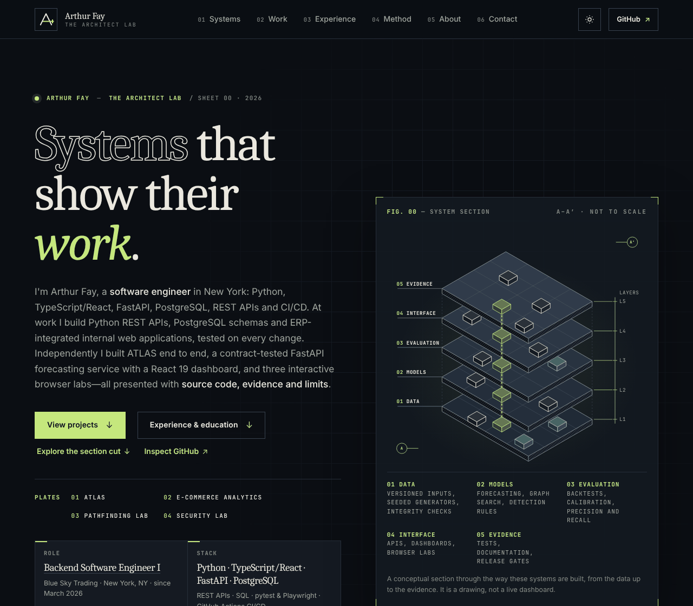 | 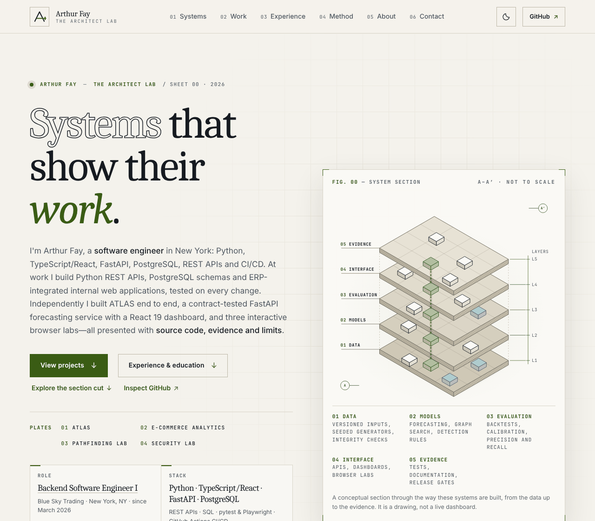 |
| 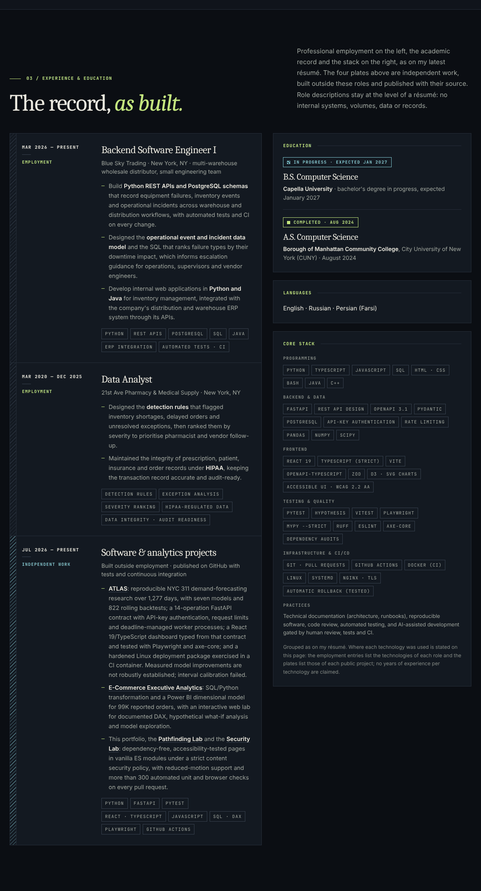 | 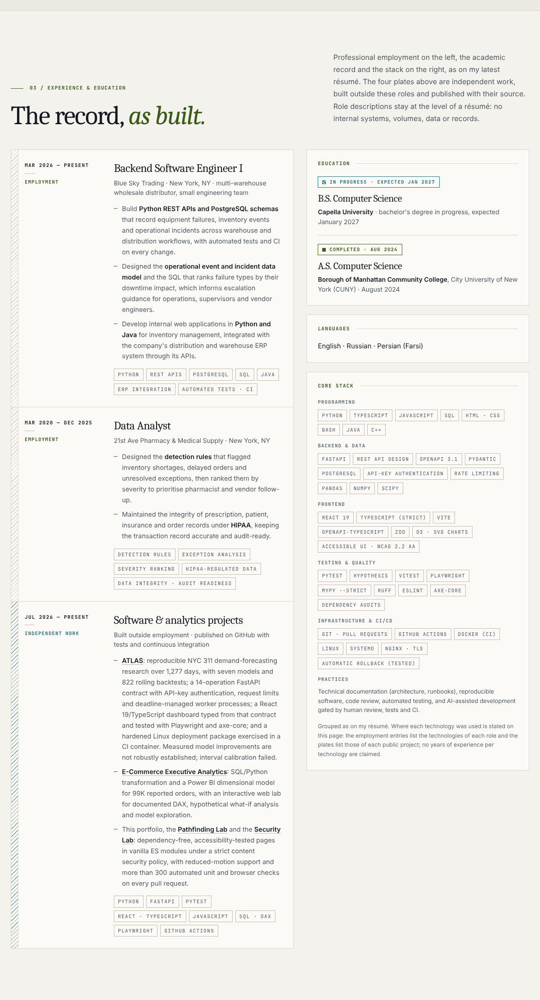 |
| 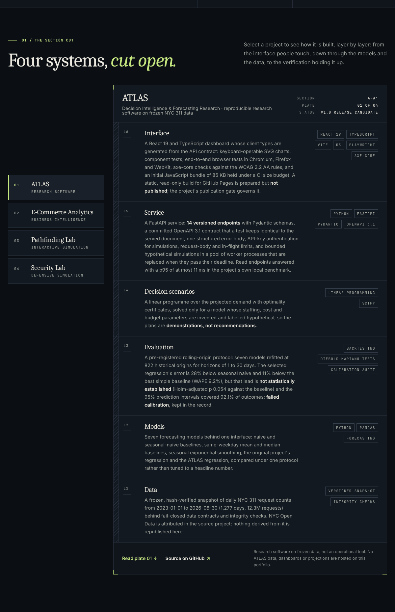 | 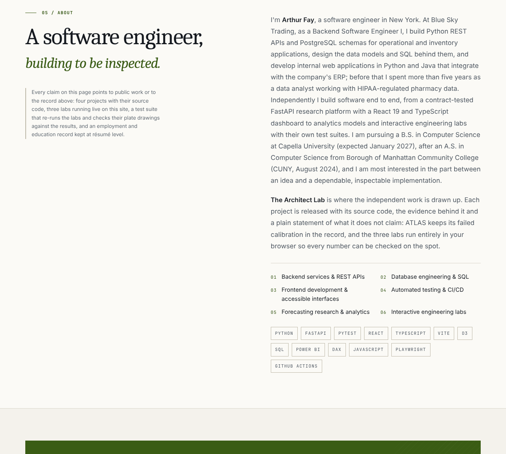 |
| 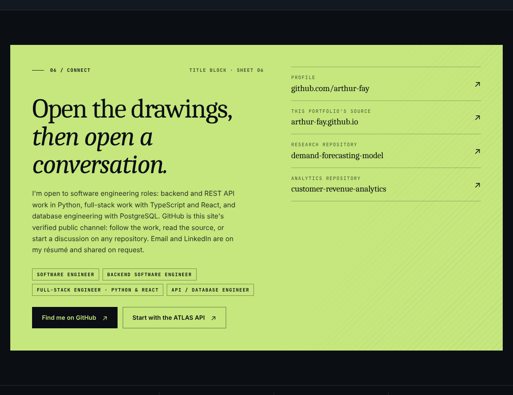 | 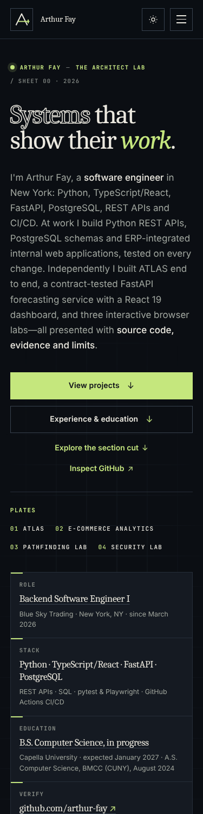 |
| 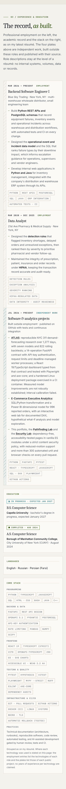 | 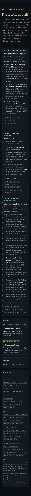 |
| 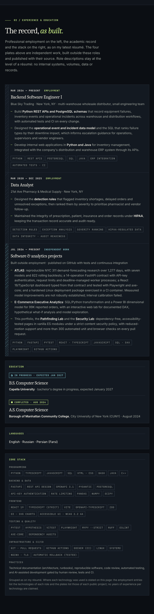 | 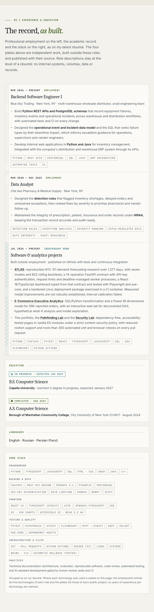 |
| 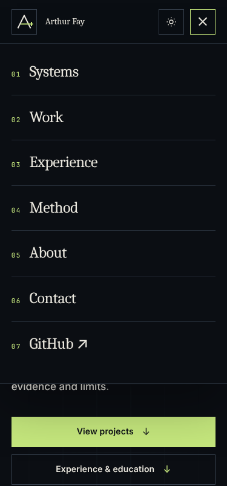 | |
| 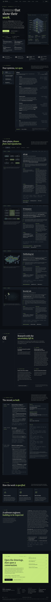 | 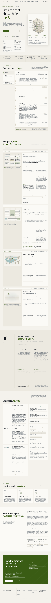 |

## 9. Remaining risks and items for the owner's approval

1. **Branch name.** The work is on the session's designated branch `claude/arthur-fay-resume-update-wmuils`, not `feat/latest-resume-professional-update`; rename it before merging if the name matters.
2. **Employer wording.** The employer descriptor ("multi-warehouse wholesale distributor, small engineering team") and the three résumé-level bullets are the owner's statements; confirm they may appear publicly. Volumes, product counts, workflow types and the model's fields were left off deliberately.
3. **"Full-Stack Engineer · Python & React"** in the contact roles is an inference from the headline and the ATLAS dashboard, not a phrase on the résumé; remove it if it overstates the target role.
4. **The practices line** on the stack card says "AI-assisted development gated by human review, tests and CI" (the résumé names the tool; the site does not). Remove it if it should not be public.
5. **Contact details.** The LinkedIn URL, the e-mail address and a résumé download remain unpublished until the owner decides (README, "Contact and privacy").
6. **Lab accessibility follow-up (pre-existing, not changed here).** axe reports `scrollable-region-focusable` (keyboard users cannot scroll an overflowing region) on the analytics lab's DAX code blocks at desktop width and on the table wrappers and the timeline frame of all three labs at phone width, and the best-practice landmark note on each lab's `<aside>`. The fix is small (a `tabindex="0"` and a label on each scroll container) but it changes the labs' tab order, which their browser tests assert, so it belongs in its own change.
7. **Figures not published.** The résumé's "57 cross-browser Playwright tests" is not stated on the site (58 declarations counted; executions differ per browser project). Confirm the résumé figure against a Playwright report before using it elsewhere.
8. **Dates.** The independent-work entry says "Jul 2026 — Present" because the portfolio is ongoing; the résumé dates ATLAS Jul–Oct 2026. Both are consistent with the repositories.
9. **Not exercised:** screen readers, Firefox, Safari, real devices, Lighthouse. The ATLAS figures are transcribed from the repository at `98a88b5`; if the research record changes, the section cut, the plate, the detail sheet, the README and `tests/unit/profile.test.js` must change together.

Merging into `main` publishes through GitHub Pages. This branch deliberately does not merge, deploy or modify Pages settings.
